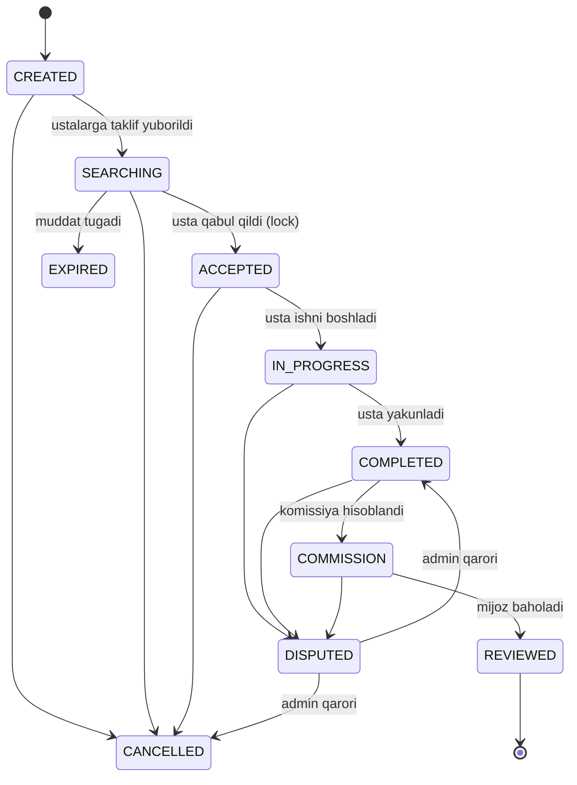
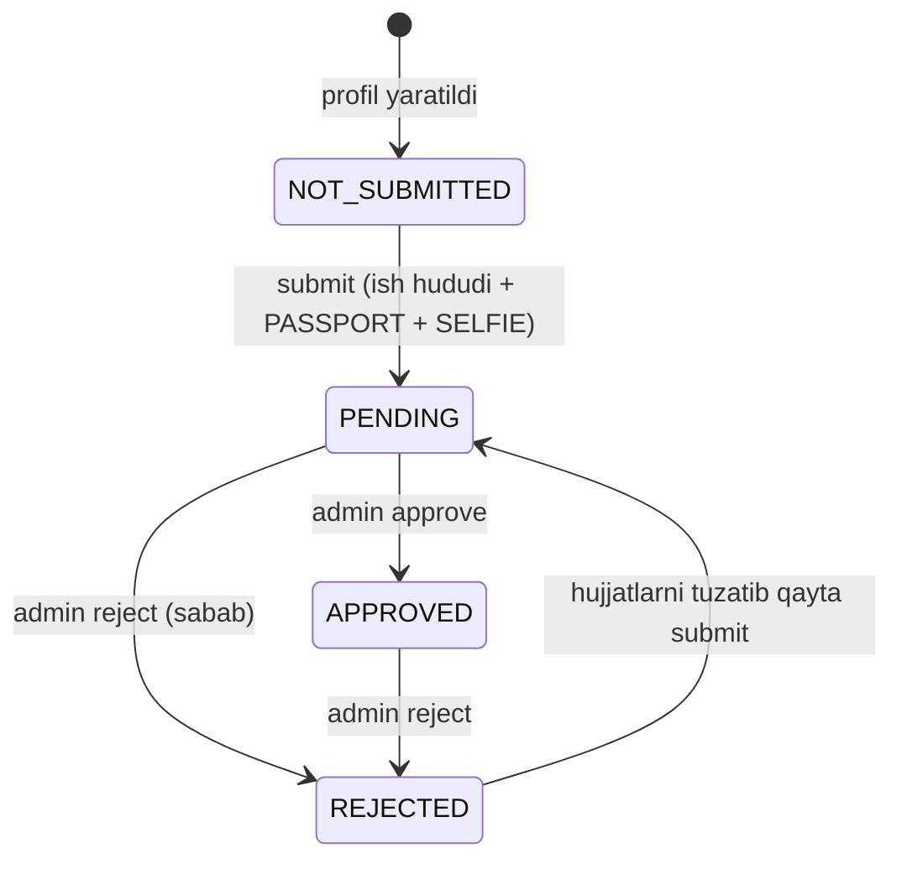
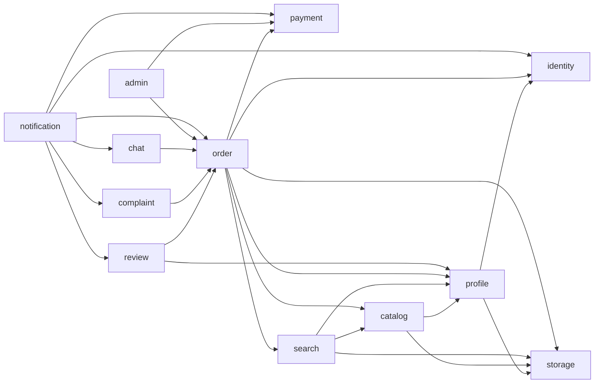
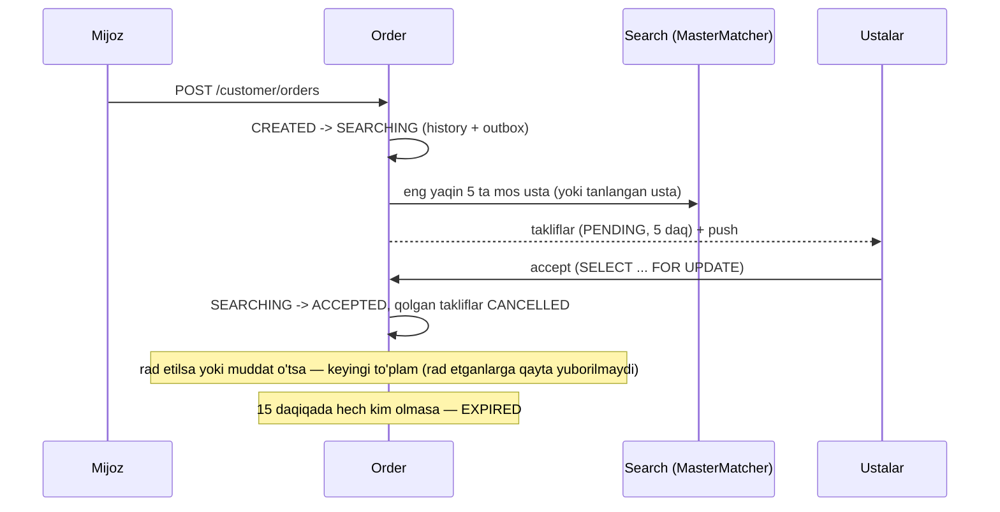
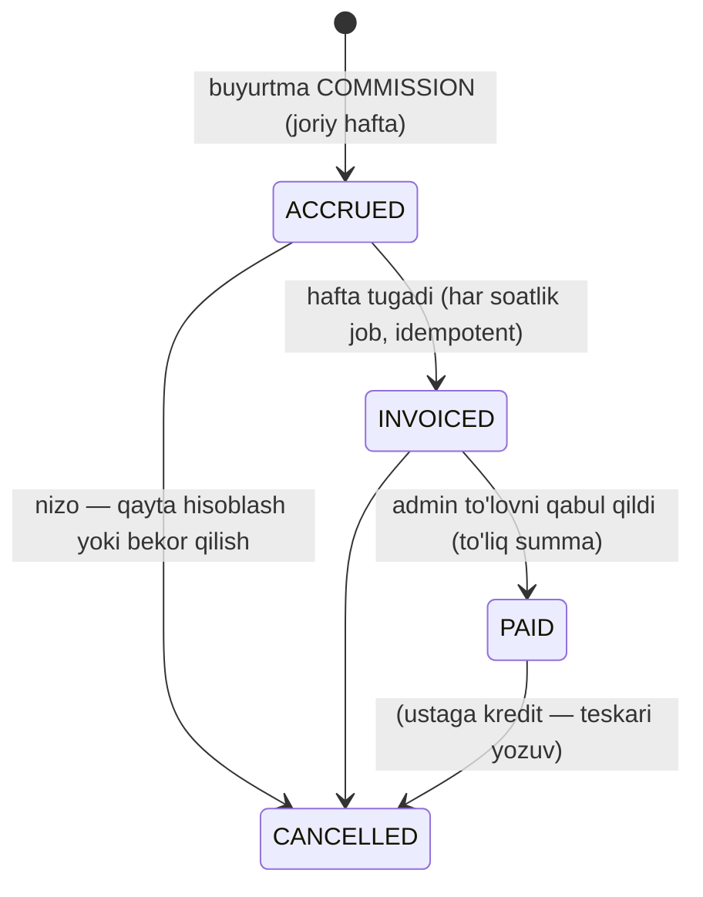

# Arxitektura

## 1. Qaror: Modular monolit (DDD)

Bitta deploy qilinadigan Spring Boot ilovasi, ichida aniq chegarali modullar. Modullar faqat
bir-birining **ochiq API**'si (modul paketining ildizidagi interfeys/DTO/event) orqali
gaplashadi; `internal` sub-paketlar yopiq. Bu qoida testlar bilan majburlanadi:

- `ModularityTest` — Spring Modulith: `internal` paketlarga murojaat va sikllik bog'liqlik yo'q
- `ArchitectureRulesTest` — ArchUnit: controller → repository to'g'ridan-to'g'ri murojaat yo'q,
  entity'lar API javobida qaytmaydi va h.k.

Mikroservisga ajratish mezoni: modulning mustaqil masshtablanishi, alohida jamoa egaligi yoki
alohida operatsion talab (masalan chat/WebSocket). Modullar orasidagi eventlar allaqachon
outbox orqali o'tgani uchun ajratish broker (RabbitMQ/Kafka) ulashga qisqaradi.

## 2. Qatlamlar

```
Client (mobil / web — keyin)
   │  HTTPS, WSS
Edge: DNS/CDN → Nginx (TLS, rate limit, X-Request-Id, /actuator yopiq)
   │
API: REST /api/v1/** + WebSocket /ws  (JWT, Bean Validation, rate limit, i18n)
   │
Spring Boot modular monolit
   ├─ identity      telefon + OTP, JWT access/refresh, rollar
   ├─ profile       mijoz/usta profillari, manzillar, verifikatsiya
   ├─ catalog       kategoriyalar (ierarxik), xizmatlar, usta xizmatlari, portfolio
   ├─ search        PostGIS geo qidiruv, filtr/saralash, Redis cache
   ├─ order         status mashinasi, takliflar, expire/retry
   ├─ review        baho va sharhlar, reyting agregatsiyasi
   ├─ payment       to'lov, komissiya, ledger (P2–P3: interface + stub)
   ├─ chat          WebSocket chat
   ├─ notification  FCM push, SMS, in-app bildirishnomalar
   ├─ complaint     shikoyat va nizolar
   ├─ storage       S3-mos fayl saqlash (MinIO)
   ├─ admin         admin API fasadi
   └─ shared        xatolik formati, i18n, security bazasi, outbox, util (domen logikasi yo'q)
   │
Data & infra: PostgreSQL+PostGIS · Redis · MinIO/S3 · outbox_events · Prometheus/Grafana
```

## 3. Modul ichki tuzilmasi

```
order/
├── OrderApi.java              ← boshqa modullar uchun ochiq interfeys
├── OrderStatusChanged.java    ← ochiq domen eventi
├── package-info.java          ← @ApplicationModule
└── internal/
    ├── domain/                ← entity, value object, status mashinasi
    ├── application/           ← use-case servislar (@Transactional)
    ├── persistence/           ← Spring Data repository
    └── web/                   ← controller, request/response DTO, MapStruct mapper
```

## 4. Eventlar: Transactional Outbox

1. Biznes o'zgarish va `outbox_events` qatori **bitta tranzaksiyada** yoziladi (`OutboxPublisher`).
2. `OutboxRelay` (ShedLock bilan, klasterda bitta instansiya) yetkazilmagan qatorlarni
   `FOR UPDATE SKIP LOCKED` bilan oladi va `OutboxDispatcher`'ga beradi.
3. Hozirgi dispatcher — in-process Spring `ApplicationEvent`. Keyin RabbitMQ/Kafka dispatcher'i
   bilan almashtiriladi, biznes kod o'zgarmaydi.
4. Xatoda eksponensial qayta urinish (`max-attempts`, `retry-backoff`), yetkazilganlar
   `retention` dan keyin tozalanadi. Metrikalar: `outbox.events.pending`, `outbox.events.published`, `outbox.events.failed`, `outbox.events.dead`.

Iste'molchilar idempotent bo'lishi shart (event `id` bo'yicha).

## 5. Buyurtma status mashinasi



`REJECTED` — buyurtma emas, alohida **taklif** (`order_master_offers.offer_status`) holati:
usta rad etsa buyurtma `SEARCHING`'da qoladi va keyingi ustaga taklif yuboriladi.

Har bir o'tish: ruxsat jadvali tekshiriladi → `order_status_history` yoziladi → outbox event →
bildirishnoma. Bir vaqtda ikki usta qabul qilmasligi uchun `orders` qatori `SELECT … FOR UPDATE`
bilan qulflanadi, qo'shimcha ravishda `@Version` (optimistic lock).

## 6. ER diagramma (rejalashtirilgan sxema)

Jadvallar modul bo'yicha alohida Flyway migratsiyalarida qo'shiladi. Hamma ID — UUID (v7,
vaqt bo'yicha tartiblangan), pul — `NUMERIC(14,2)` UZS.

```mermaid
erDiagram
    users ||--o{ user_roles : has
    users ||--o| customer_profiles : has
    users ||--o| master_profiles : has
    users ||--o{ addresses : has
    users ||--o{ refresh_tokens : has
    categories ||--o{ categories : parent
    categories ||--o{ services : contains
    master_profiles ||--o{ master_services : offers
    services ||--o{ master_services : ""
    master_profiles ||--o{ master_portfolio : has
    users ||--o{ orders : "customer"
    master_profiles ||--o{ orders : "master"
    services ||--o{ orders : ""
    orders ||--o{ order_master_offers : ""
    orders ||--o{ order_status_history : ""
    orders ||--o{ order_attachments : ""
    orders ||--o| reviews : ""
    orders ||--o{ payments : ""
    orders ||--o{ transactions : ""
    orders ||--o{ commission_reports : ""
    orders ||--o| chats : ""
    chats ||--o{ messages : ""
    orders ||--o{ complaints : ""
    users ||--o{ notifications : ""

    users { uuid id PK; varchar phone UK; varchar status; timestamptz created_at }
    master_profiles { uuid user_id PK; varchar verification_status; bool is_verified; numeric rating_avg; int rating_count; geography work_area }
    addresses { uuid id PK; uuid user_id FK; geography geo_point "GIST"; bool is_default }
    master_services { uuid id PK; uuid master_id FK; uuid service_id FK; numeric price_from; bool is_active }
    orders { uuid id PK; uuid customer_id FK; uuid master_id FK; uuid service_id FK; varchar status; numeric price; timestamptz scheduled_at; jsonb address_snapshot; bigint version }
    order_master_offers { uuid id PK; uuid order_id FK; uuid master_id FK; varchar offer_status }
    reviews { uuid id PK; uuid order_id UK; smallint rating "CHECK 1..5"; text comment }
    outbox_events { uuid id PK; varchar event_type; jsonb payload; timestamptz published_at }
```

## 7. Redis kalitlari

| Kalit | TTL | Maqsad |
|---|---|---|
| `otp:{phone}` | 2 daqiqa | OTP kodi HMAC-SHA256 hash'i va urinishlar soni (kodning o'zi saqlanmaydi) |
| `otp:cd:{phone}` | 60 s | qayta yuborish cooldown'i |
| `rl:{scope}:{key}` | oyna davomiyligi | rate limit (Lua, atomik): `otp-request:phone`, `otp-request:ip`, `otp-verify:ip` |
| `online:{masterId}` | 90 s (heartbeat) | usta online holati (bitta/bir nechta ustani tekshirish — MGET) |
| `online:masters` | — (eskilari har heartbeat'da tozalanadi) | sorted set, score = oxirgi heartbeat; "faqat online" filtri |
| `search:ver` | — | qidiruv keshi versiyasi; indeks o'zgarganda INCR (commit'dan keyin) |
| `search:v{ver}:{sha256}` | 60 s | qidiruv natijalari keshi (versiya o'zgarsa eski kalitlar o'qilmaydi, TTL bilan o'chadi) |
| `rl:chat-send:{userId}` | 1 daq | chat: daqiqasiga 30 ta xabar |
| `ws:chat` (pub/sub kanal) | — | chat hodisalarini barcha API instansiyalariga tarqatish |

## 8. Xatolik formati

RFC 9457 `application/problem+json`, barcha xatolar uchun bir xil:

```json
{
  "type": "urn:usta:error:validation_failed",
  "title": "So'rov ma'lumotlari noto'g'ri",
  "status": 400,
  "detail": "So'rov ma'lumotlari noto'g'ri",
  "instance": "/api/v1/auth/otp",
  "code": "VALIDATION_FAILED",
  "traceId": "6f1c2b...",
  "timestamp": "2026-11-18T10:00:00Z",
  "errors": [{ "field": "phone", "message": "Telefon raqam formati noto'g'ri" }]
}
```

Matnlar `Accept-Language` (uz/ru/en, standart — uz) bo'yicha lokalizatsiya qilinadi;
mijoz ilovalar `code` maydoniga tayanishi kerak.

## 9. Autentifikatsiya va rollar (P2)

```mermaid
sequenceDiagram
    participant App as Mobil ilova
    participant API
    participant Redis
    participant SMS as SMS provayder
    App->>API: POST /auth/otp/request {phone}
    API->>Redis: cooldown + rate limit, otp:{phone} = HMAC(kod)
    API->>SMS: "tasdiqlash kodi 12345"
    App->>API: POST /auth/otp/verify {phone, code}
    API->>Redis: urinishlar++, kod mos -> o'chirish (bir martalik)
    API-->>App: accessToken (JWT, 15 daq) + refreshToken (30 kun), newUser
    App->>API: POST /me/roles {CUSTOMER|MASTER}  (birinchi kirishda)
    API-->>App: yangi rollar bilan accessToken
    App->>API: POST /auth/refresh {refreshToken}
    API-->>App: yangi juftlik (rotatsiya); eski token qayta kelsa — butun family bekor
```

- **Access token** — HS256 JWT (`sub`=userId, `roles`), stateless tekshiriladi. **Refresh token** — tasodifiy
  256-bit qiymat, DB'da faqat SHA-256 hash'i (`refresh_tokens`), qurilma bo'yicha `family_id`.
- **Rollar**: `CUSTOMER`, `MASTER` (foydalanuvchi o'zi tanlaydi, ikkalasi ham bo'lishi mumkin), `ADMIN` (faqat
  `ADMIN_PHONES` orqali yoki DB'da). Yo'llar: `/api/v1/customer/**`, `/api/v1/master/**`, `/api/v1/admin/**`.
- **Bloklash**: refresh tokenlar darhol bekor, `/me` va boshqa so'rovlar `USER_BLOCKED` qaytaradi, usta profili
  outbox eventi orqali nofaol bo'ladi (qidiruvdan yo'qoladi).
- Admin amallari `audit_logs` jadvaliga yoziladi (kim, nima, qachon).

## 10. Usta verifikatsiyasi



Hujjatlar faqat `NOT_SUBMITTED`/`REJECTED` holatida o'zgartiriladi. Mijozlarga faqat `APPROVED` va faol ustalar
ko'rinadi; aniq ish joyi koordinatasi ommaviy kartochkada qaytarilmaydi.

## 11. Fayllar

Bucket private. Fayl turi `Content-Type` bo'yicha emas, birinchi baytlar (magic bytes) bo'yicha aniqlanadi;
hajm `FilePurpose` bo'yicha (avatar 5MB, hujjat/portfolio 10MB). Mijozga 15 daqiqalik presigned GET URL
beriladi; compose'da nginx `/{bucket}/` ni faqat GET/HEAD uchun MinIO'ga uzatadi. Tranzaksiya rollback bo'lsa
yuklangan fayl o'chiriladi, o'chirish esa commit'dan keyin bajariladi.

## 12. Modullar bog'liqligi



Sikllar yo'q (`ModularityTest`). Identity OTP yuborish uchun o'z `OtpDelivery` portini e'lon qiladi, notification
uni SMS orqali amalga oshiradi — shuning uchun notification boshqa modullar eventlarini sikl yaratmasdan tinglaydi.

## 13. Qidiruv (read model)

Search moduli profile/catalog jadvallarini o'qimaydi. U o'z jadvallarini (`search_masters`,
`search_master_services`) outbox eventlari asosida yangilaydi: `profile.*`, `catalog.master-services-changed`,
`catalog.changed`. Indekslovchi har doim manbadan joriy holatni o'qiydi, shuning uchun idempotent va eventlar
tartibiga bog'liq emas. Indeks bo'sh bo'lsa, ilova ishga tushganda qayta quriladi; qo'lda qurish uchun
`POST /api/v1/admin/search/reindex`.

Mos usta: tasdiqlangan, faol, ish hududi kiritilgan va xizmatni faol taklif qiladi. So'rovdagi nuqta ham qidiruv
radiusi ichida (`ST_DWithin`, GIST), ham ustaning o'z ish radiusi ichida bo'lishi kerak. Saralash:
`rating_avg ↓, rating_count ↓, masofa ↑` (shuningdek DISTANCE, PRICE). Pagination majburiy (maksimum 50).
Indeks eventual consistent: o'zgarish relay davri (~2 s) ichida ko'rinadi.

## 14. Buyurtmani taqsimlash



- Parallel qabul qilish himoyasi uch qatlamli: `orders` qatori `FOR UPDATE` qulfi, `@Version` va qisman
  unique indeks `uq_offers_accepted` (bitta buyurtmada bitta ACCEPTED taklif).
- `OrderMaintenance` (har 30 s, ShedLock): muddati o'tgan takliflarni EXPIRED qiladi, qidiruv muddati o'tgan
  buyurtmalarni EXPIRED qiladi, ochiq taklifi qolmagan buyurtmalarni qayta taqsimlaydi. Har buyurtma alohida
  tranzaksiyada qayta ishlanadi.
- Narx: qabul qilganda ustaning "narx dan" qiymati (`price_from`) yoziladi, yakuniy narxni (`price`) usta ish
  oxirida kiritadi. Shu paytning o'zida komissiya hisoblanadi (`payment.Commissions`, 10%) va buyurtma
  COMPLETED → COMMISSION ga o'tadi.
- Ustaga taklif bosqichida faqat ko'cha manzili va masofa ko'rinadi. Aniq manzil (podyezd, xonadon,
  koordinata) va mijoz telefoni qabul qilingandan keyin ochiladi. Telefonlar faqat ACCEPTED va IN_PROGRESS
  holatlarida ko'rsatiladi.

## 15. Baho va bildirishnomalar

Baho bitta tranzaksiyada saqlanadi. Ketma-ketlik: buyurtma qulflanadi va tekshiriladi (egasi;
COMPLETED/COMMISSION) → `reviews` → `master_profiles` atomik UPDATE (`rating_sum`, `rating_count`;
`rating_avg = round(sum/count, 2)`) → REVIEWED → outbox. `rating_sum` yaxlitlash xatolari to'planmasligi uchun
saqlanadi.

Bildirishnomalar order/review eventlaridan yaratiladi (`notifications`). Bir xil event qayta kelsa, bir
foydalanuvchiga ikkinchi marta yozilmaydi: `(source_event_id, user_id)` UNIQUE. Matn turi va argumentlari
saqlanadi va o'qish paytida `Accept-Language` tilida hosil qilinadi. Push commit'dan keyin har qurilmaga o'z
tilida yuboriladi (`push_tokens.locale`). Adapter `PushSender`: hozircha `log`, FCM kalitlari kelganda `fcm`.

## 16. To'lov, komissiya va ledger (P4)

Model — naqd: mijoz ustaga to'laydi, usta platformaga komissiya (10%) qarzdor bo'ladi.



- **commission_reports** — har buyurtmaga bitta amaldagi qator (`uq_commission_active_order`). `period` —
  hafta boshi (dushanba, Asia/Tashkent). Nizodan keyin narx o'zgarsa, eski qator CANCELLED bo'ladi va yangisi
  joriy haftada yoziladi.
- **transactions** (ledger) — faqat qo'shiladi, o'zgartirilmaydi (`UPDATE` va `DELETE` DB trigger bilan
  taqiqlangan). Usta balansi — yozuvlar yig'indisi; manfiy bo'lsa — qarz. `COMMISSION_CHARGE` (−),
  `COMMISSION_REVERSAL` (+), `COMMISSION_PAYMENT` (+). Ishoralar `CHECK` bilan majburlanadi.
- **payments** — mijoz to'lovi (hozir CASH/PAID). Provayder `PaymentGateway` interfeysi orqali ulanadi:
  Click, Payme yoki Uzum uchun yangi adapter qo'shiladi, komissiya va ledger mantig'i o'zgarmaydi.
- Komissiya order'ning tranzaksiyasida yoziladi: buyurtma COMMISSION holatida bo'lsa, komissiya ham albatta bor.
- **Reconciliation** (admin moduli, har kecha + `GET /admin/finance/reconciliation`) har yakunlangan
  buyurtma uchun uch manbani solishtiradi: `orders.commission_amount`, amaldagi `commission_reports` va ledger'dagi
  sof summa. Farqlar ro'yxatda va `finance.reconciliation.mismatches` metrikasida ko'rinadi.
- V14 — P4 dan oldin yakunlangan buyurtmalar uchun backfill.

## 17. Chat (WebSocket)

STOMP over WebSocket: `wss://<host>/ws`. Nginx `/ws` ni Upgrade bilan proksilaydi.

| Kadr | Manzil | Izoh |
|---|---|---|
| CONNECT | — | `Authorization: Bearer <access token>` (REST bilan bir xil JWT) |
| SUBSCRIBE | `/topic/orders.{orderId}.chat` | faqat buyurtma mijozi va biriktirilgan usta |
| SEND | `/app/orders.{orderId}.chat` | `{"content":"..."}` |
| SEND | `/app/orders.{orderId}.chat.read` | o'qildi |
| SUBSCRIBE | `/user/queue/errors` | yuborishdagi xatolar (`code`) |

- Hodisalar: `{"type":"MESSAGE","message":{...}}` va `{"type":"READ","readerId","readAt"}`.
- Xabar avval DB'ga yoziladi. Commit'dan keyin hodisa Redis pub/sub (`ws:chat`) orqali barcha instansiyalarga
  tarqatiladi va har biri uni o'z STOMP broker'iga uzatadi, shuning uchun API'ni bir nechta instansiyada
  ishga tushirish mumkin.
- REST muqobili: `GET/POST /api/v1/orders/{id}/chat/messages` (keyset pagination `?before=`).
- Chat usta qabul qilganda ochiladi. Yozish faqat ish faol bo'lganda mumkin (ACCEPTED…DISPUTED), keyin chat
  faqat o'qish uchun qoladi. Admin nizolarni ko'rib chiqish uchun chatni o'qiy oladi.
- Yangi xabar qabul qiluvchiga faqat push orqali boradi; in-app ro'yxatga yozilmaydi, chatning o'zida
  o'qilmaganlar soni bor.

## 18. Shikoyatlar va nizolar

Mijoz yoki usta buyurtma bo'yicha ikkinchi tomonga shikoyat qiladi (`QUALITY`, `NO_SHOW`, `PRICE`, `BEHAVIOR`,
`FRAUD`, `OTHER`). `dispute=true` bo'lsa, shu tranzaksiyada buyurtma DISPUTED ga o'tadi va baholash hamda
to'lov to'xtaydi. Admin shikoyatni oladi (OPEN → IN_REVIEW) va yopadi (RESOLVED | REJECTED). Nizo ochiq
bo'lsa, buyurtma bo'yicha qaror (`orderResolution`) ham majburiy:

- COMPLETED (yangi narx bilan) — komissiya qayta hisoblanadi;
- CANCELLED — komissiya qaytariladi, to'lov REFUNDED bo'ladi.

Muallifga natija haqida bildirishnoma yuboriladi. `complaintsAgainstUser` — foydalanuvchiga nisbatan jami
shikoyatlar soni, blok qarori uchun.
