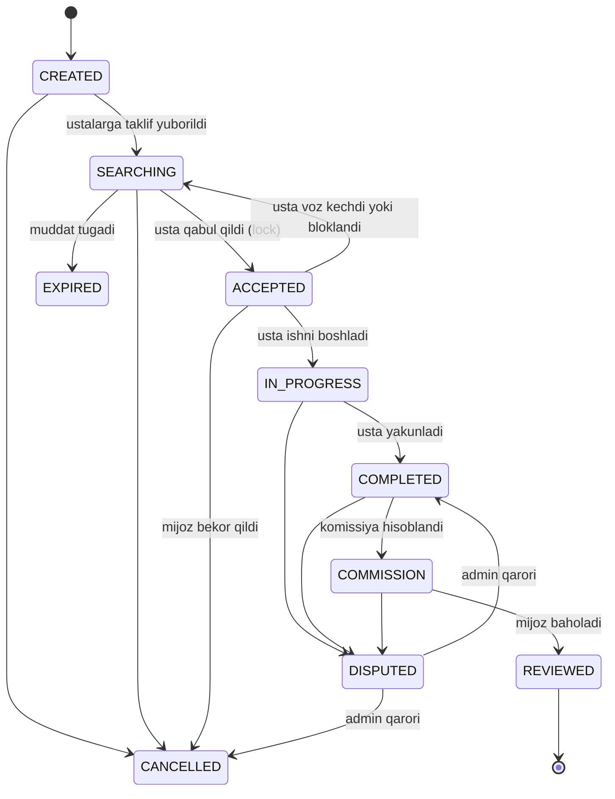
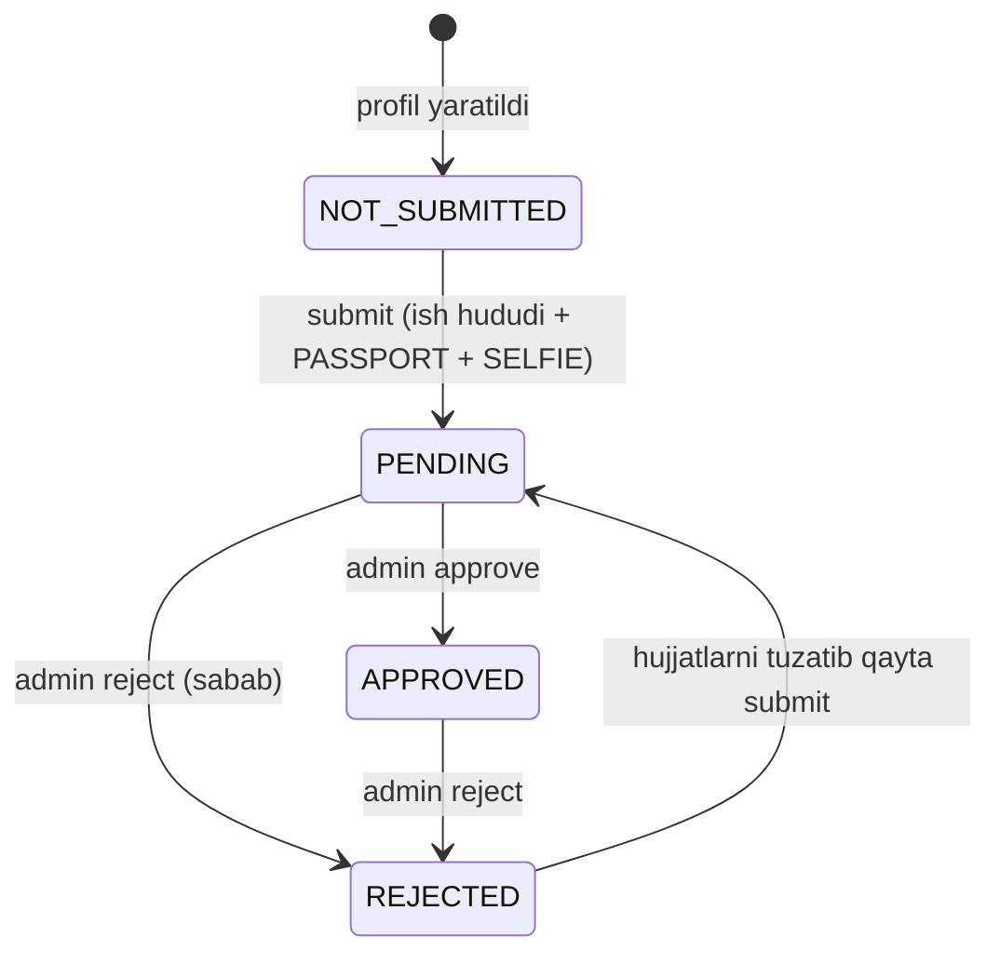
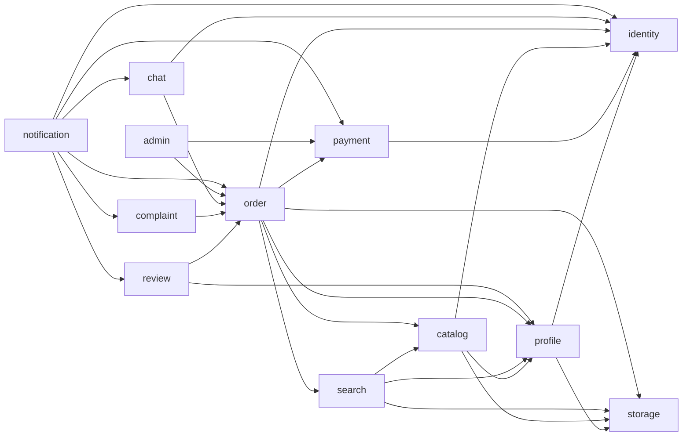
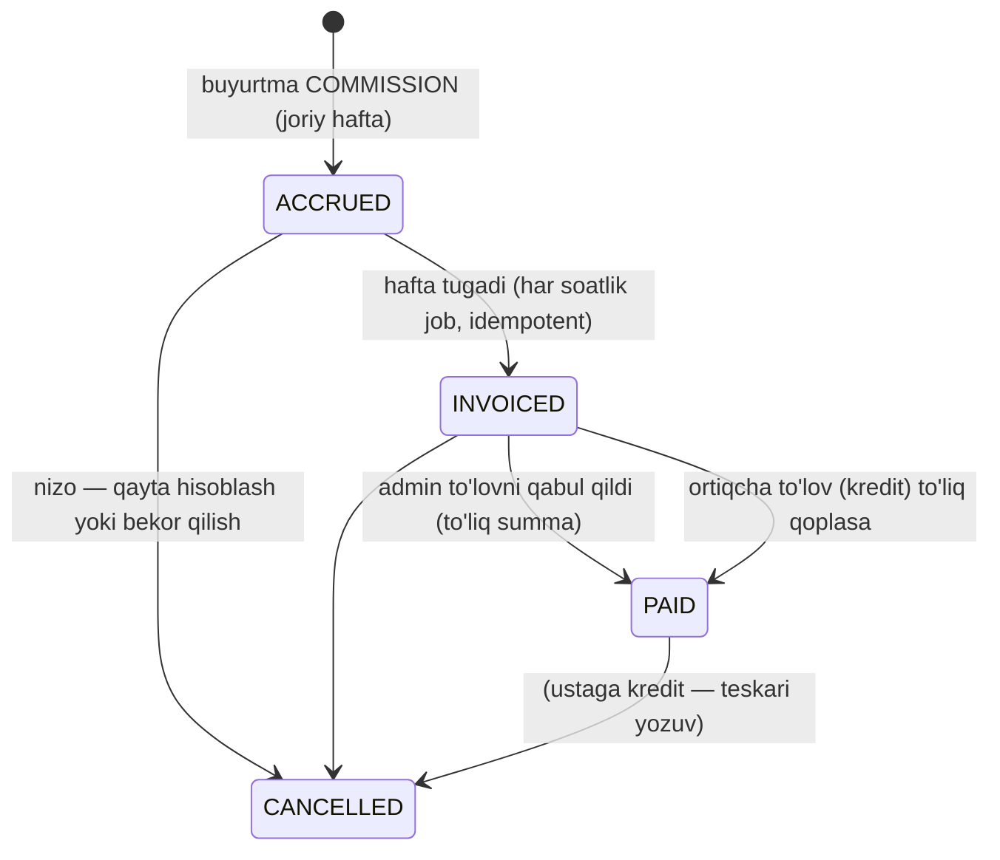

# Arxitektura

## 1. Qaror: Modular monolit (DDD)

Bitta deploy qilinadigan Spring Boot ilovasi, ichida aniq chegarali modullar. Modullar faqat
bir-birining **ochiq API**'si (modul paketining ildizidagi interfeys/DTO/event) orqali
gaplashadi; `internal` sub-paketlar yopiq. Bu qoida testlar bilan majburlanadi:

- `ModularityTest` — Spring Modulith: `internal` paketlarga murojaat va sikllik bog'liqlik yo'q
- `ArchitectureRulesTest` — ArchUnit: controller → repository to'g'ridan-to'g'ri murojaat yo'q,
  entity'lar API javobida qaytmaydi va h.k.

Mikroservisga ajratish mezoni: modulning mustaqil masshtablanishi, alohida jamoa egaligi yoki
alohida operatsion talab (masalan chat/WebSocket). Modullar orasidagi eventlar allaqachon
outbox orqali o'tgani uchun ajratish broker (RabbitMQ/Kafka) ulashga qisqaradi.

## 2. Qatlamlar

```
Client (mobil / web — keyin)
   │  HTTPS, WSS
Edge: DNS/CDN → Nginx (TLS, rate limit, X-Request-Id, /actuator yopiq)
   │
API: REST /api/v1/** + WebSocket /ws  (JWT, Bean Validation, rate limit, i18n)
   │
Spring Boot modular monolit
   ├─ identity      telefon + OTP, JWT access/refresh, rollar
   ├─ profile       mijoz/usta profillari, manzillar, verifikatsiya
   ├─ catalog       kategoriyalar (ierarxik), xizmatlar, usta xizmatlari, portfolio
   ├─ search        PostGIS geo qidiruv, filtr/saralash, Redis cache
   ├─ order         status mashinasi, takliflar, expire/retry
   ├─ review        baho va sharhlar, reyting agregatsiyasi
   ├─ payment       to'lov, komissiya, ledger (P2–P3: interface + stub)
   ├─ chat          WebSocket chat
   ├─ notification  FCM push, SMS, in-app bildirishnomalar
   ├─ complaint     shikoyat va nizolar
   ├─ storage       S3-mos fayl saqlash (MinIO)
   ├─ admin         admin API fasadi
   └─ shared        xatolik formati, i18n, security bazasi, outbox, util (domen logikasi yo'q)
   │
Data & infra: PostgreSQL+PostGIS · Redis · MinIO/S3 · outbox_events · Prometheus/Grafana
```

## 3. Modul ichki tuzilmasi

```
order/
├── OrderApi.java              ← boshqa modullar uchun ochiq interfeys
├── OrderStatusChanged.java    ← ochiq domen eventi
├── package-info.java          ← @ApplicationModule
└── internal/
    ├── domain/                ← entity, value object, status mashinasi
    ├── application/           ← use-case servislar (@Transactional)
    ├── persistence/           ← Spring Data repository
    └── web/                   ← controller, request/response DTO, MapStruct mapper
```

## 4. Eventlar: Transactional Outbox

1. Biznes o'zgarish va `outbox_events` qatori **bitta tranzaksiyada** yoziladi (`OutboxPublisher`).
2. `OutboxRelay` yetkazilmagan qatorlarni `FOR UPDATE SKIP LOCKED` bilan oladi (bir nechta instansiya
   parallel ishlay oladi, ShedLock faqat tozalash vazifasida) va `OutboxDispatcher`'ga beradi.
3. Hozirgi dispatcher — in-process Spring `ApplicationEvent`. Keyin RabbitMQ/Kafka dispatcher'i
   bilan almashtiriladi, biznes kod o'zgarmaydi.
4. Xatoda eksponensial qayta urinish (`retry-backoff` har safar ikki baravar, 1 soatgacha;
   `max-attempts` tugasa "dead" — `GET /admin/outbox/dead`, `POST /admin/outbox/dead/retry`), yetkazilganlar
   `retention` dan keyin tozalanadi. Metrikalar: `outbox.events.pending`, `outbox.events.published`, `outbox.events.failed`, `outbox.events.dead`.

Iste'molchilar idempotent bo'lishi shart (event `id` bo'yicha).

## 5. Buyurtma status mashinasi



`REJECTED` — buyurtma emas, alohida **taklif** (`order_master_offers.offer_status`) holati:
usta rad etsa buyurtma `SEARCHING`'da qoladi va keyingi ustaga taklif yuboriladi. Qabul qilgan usta ish
boshlanmasdan voz kechsa, buyurtma bekor bo'lmaydi: yangi muddat bilan `SEARCHING`ga qaytadi (voz kechgan
usta qayta taklif olmaydi, shu paytgacha yopilgan takliflar qayta ochiladi).

Har bir o'tish: ruxsat jadvali tekshiriladi → `order_status_history` yoziladi → outbox event →
bildirishnoma. Bir vaqtda ikki usta qabul qilmasligi uchun `orders` qatori `SELECT … FOR UPDATE`
bilan qulflanadi, qo'shimcha ravishda `@Version` (optimistic lock).

## 6. ER diagramma (rejalashtirilgan sxema)

Jadvallar modul bo'yicha alohida Flyway migratsiyalarida qo'shiladi. Hamma ID — UUID (v7,
vaqt bo'yicha tartiblangan), pul — `NUMERIC(14,2)` UZS.

```mermaid
erDiagram
    users ||--o{ user_roles : has
    users ||--o{ user_permissions : "admin"
    users ||--o| customer_profiles : has
    users ||--o| master_profiles : has
    users ||--o{ addresses : has
    users ||--o{ refresh_tokens : has
    categories ||--o{ categories : parent
    categories ||--o{ services : contains
    master_profiles ||--o{ master_services : offers
    services ||--o{ master_services : ""
    master_profiles ||--o{ master_portfolio : has
    users ||--o{ orders : "customer"
    master_profiles ||--o{ orders : "master"
    services ||--o{ orders : ""
    orders ||--o{ order_master_offers : ""
    orders ||--o{ order_status_history : ""
    orders ||--o{ order_attachments : ""
    orders ||--o| reviews : ""
    orders ||--o{ payments : ""
    orders ||--o{ transactions : ""
    orders ||--o{ commission_reports : ""
    orders ||--o{ chats : "har usta uchun"
    chats ||--o{ messages : ""
    orders ||--o{ complaints : ""
    users ||--o{ notifications : ""

    users { uuid id PK; varchar phone UK; varchar status; timestamptz created_at }
    master_profiles { uuid user_id PK; varchar verification_status; bool is_verified; numeric rating_avg; int rating_count; geography work_area }
    addresses { uuid id PK; uuid user_id FK; geography geo_point "GIST"; bool is_default }
    master_services { uuid id PK; uuid master_id FK; uuid service_id FK; numeric price_from; bool is_active }
    orders { uuid id PK; uuid customer_id FK; uuid master_id FK; uuid service_id FK; varchar status; numeric price; timestamptz scheduled_at; jsonb address_snapshot; bigint version }
    order_master_offers { uuid id PK; uuid order_id FK; uuid master_id FK; varchar offer_status }
    reviews { uuid id PK; uuid order_id UK; smallint rating "CHECK 1..5"; text comment }
    outbox_events { uuid id PK; varchar event_type; jsonb payload; timestamptz published_at }
```

## 7. Redis kalitlari

| Kalit | TTL | Maqsad |
|---|---|---|
| `otp:{phone}` | 2 daqiqa | OTP kodi HMAC-SHA256 hash'i va urinishlar soni (kodning o'zi saqlanmaydi) |
| `otp:cd:{phone}` | 60 s | qayta yuborish cooldown'i |
| `otp:fail:{phone}` | 24 soat | noto'g'ri urinishlar (barcha kodlar bo'yicha); 15 taga yetsa 429 |
| `rl:{scope}:{key}` | oyna davomiyligi | rate limit (Lua, atomik): `otp-request:phone`, `otp-request:phone-day`, `otp-request:ip`, `otp-verify:ip`, `order-create`, `complaint-create`, `upload` |
| `online:{masterId}` | 90 s (heartbeat) | usta online holati (bitta/bir nechta ustani tekshirish — MGET) |
| `online:masters` | — (eskilari har heartbeat'da tozalanadi) | sorted set, score = oxirgi heartbeat; "faqat online" filtri |
| `revoked:user:{id}` | access TTL + 1 daq | bloklangan/o'chirilgan foydalanuvchi tokenlarini darhol rad etish |
| `authz:ver:{id}` | access TTL + 1 daq | rol/huquq o'zgargach eski tokenlarni rad etish |
| `search:ver` | — | qidiruv keshi versiyasi; indeks o'zgarganda INCR (commit'dan keyin) |
| `search:v{ver}:{sha256}` | 60 s | qidiruv natijalari keshi (versiya o'zgarsa eski kalitlar o'qilmaydi, TTL bilan o'chadi) |
| `rl:chat-send:{userId}` | 1 daq | chat: daqiqasiga 30 ta xabar |
| `ws:chat` (pub/sub kanal) | — | chat hodisalarini barcha API instansiyalariga tarqatish |
| `ws:disconnect` (pub/sub kanal) | — | bloklangan foydalanuvchining WebSocket sessiyalarini barcha instansiyalarda uzish |

## 8. Xatolik formati

RFC 9457 `application/problem+json`, barcha xatolar uchun bir xil:

```json
{
  "type": "urn:usta:error:validation_failed",
  "title": "So'rov ma'lumotlari noto'g'ri",
  "status": 400,
  "detail": "So'rov ma'lumotlari noto'g'ri",
  "instance": "/api/v1/auth/otp",
  "code": "VALIDATION_FAILED",
  "traceId": "6f1c2b...",
  "timestamp": "2026-11-18T10:00:00Z",
  "errors": [{ "field": "phone", "message": "Telefon raqam formati noto'g'ri" }]
}
```

Matnlar `Accept-Language` (`uz` — standart, `uz-Cyrl`, `ru`, `en`) bo'yicha lokalizatsiya qilinadi; mijoz
ilovalar `code` maydoniga tayanishi kerak. Til RFC 4647 "lookup" bilan tanlanadi (`uz-Cyrl-UZ → uz-Cyrl`,
`uz-UZ → uz`). Xatolardagi resurs va holat nomlari (`resource.*`, `status.*`) ham tarjima qilinadi. Tizim yozgan
sabablar bazada kod bo'lib saqlanadi (`system:master-blocked`, `complaint:QUALITY`) va o'qishda tarjima qilinadi.
Katalog nomi `uz`/`ru`/`en` da majburiy; `uzCyrl` bo'sh bo'lsa `UzbekCyrillic` lotinchadan o'giradi.

## 9. Autentifikatsiya va rollar (P2)

```mermaid
sequenceDiagram
    participant App as Mobil ilova
    participant API
    participant Redis
    participant SMS as SMS provayder
    App->>API: POST /auth/otp/request {phone}
    API->>Redis: cooldown + rate limit, otp:{phone} = HMAC(kod)
    API->>SMS: "tasdiqlash kodi 12345"
    App->>API: POST /auth/otp/verify {phone, code}
    API->>Redis: urinishlar++, kod mos -> o'chirish (bir martalik)
    API-->>App: accessToken (JWT, 15 daq) + refreshToken (30 kun), newUser
    App->>API: POST /me/roles {CUSTOMER|MASTER}  (birinchi kirishda)
    API-->>App: yangi rollar bilan accessToken
    App->>API: POST /auth/refresh {refreshToken}
    API-->>App: yangi juftlik (rotatsiya); eski token qayta kelsa — butun family bekor
```

- **Access token** — HS256 JWT (`sub`=userId, `roles`), stateless tekshiriladi. **Refresh token** — tasodifiy
  256-bit qiymat, DB'da faqat SHA-256 hash'i (`refresh_tokens`), qurilma bo'yicha `family_id`.
- **Rollar**: `CUSTOMER`, `MASTER` (foydalanuvchi o'zi tanlaydi, ikkalasi ham bo'lishi mumkin), `ADMIN`,
  `SUPER_ADMIN`. Yo'llar: `/api/v1/customer/**`, `/api/v1/master/**`, `/api/v1/admin/**`.
- **Super admin** faqat `SUPER_ADMIN_PHONES` orqali (ro'yxatdan olinsa, rol keyingi kirish/refresh'da olinadi);
  barcha huquqlarga ega, API orqali bloklanmaydi va o'chirilmaydi. U adminlarni tayinlaydi
  (`/api/v1/admin/admins`).
- **Admin huquqlari** (`user_permissions`): `USERS`, `MASTERS`, `CATALOG`, `ORDERS`, `FINANCE`, `COMPLAINTS`,
  `SYSTEM`, `DELETE`. Token ichida `perms`; `AdminRoutes` har admin yo'lini huquqqa bog'laydi (xavfsizlik va
  API hujjati shundan foydalanadi),
  ro'yxatda yo'q admin yo'li faqat super adminga ochiq (fail closed). O'chirish qo'shimcha `DELETE` talab qiladi
  (`@PreAuthorize`). Admin boshqa adminni bloklay yoki o'chira olmaydi.
- **Huquq o'zgarishi** darhol kuchga kiradi: `users.authz_version` oshadi, Redis'dagi `authz:ver:{id}` dan eski
  `av` li token `401 TOKEN_OUTDATED` oladi, refresh yangi huquqlar bilan token beradi.
- **Bloklash**: refresh tokenlar darhol bekor, `/me` va boshqa so'rovlar `USER_BLOCKED` qaytaradi, usta profili
  outbox eventi orqali nofaol bo'ladi (qidiruvdan yo'qoladi) va WebSocket sessiyalari uziladi. Buyurtmalari:
  mijozning boshlanmagan buyurtmalari bekor qilinadi; ustaning qabul qilganlari qayta qidiruvga, boshlangan
  ishlari nizoga o'tadi, ochiq takliflari yopiladi.
- **Logout**: `pushToken` berilsa, shu qurilmaning push tokeni o'chiriladi.
- Admin amallari `audit_logs` jadvaliga yoziladi (kim, nima, qachon).

### O'chirish

**Foydalanuvchi** (`DELETE /admin/users/{id}`, `USERS` + `DELETE`) — anonimlashtirish, qaytarib bo'lmaydi.
Avval barcha `UserDeletionGuard` lar tekshiradi: boshlangan/nizodagi buyurtma (`USER_HAS_ACTIVE_ORDERS`) yoki
komissiya qarzi (`USER_HAS_DEBT`) bo'lsa — 409. Keyin telefon, rollar va sessiyalar o'chadi (`status=DELETED`,
raqam bilan qayta ro'yxatdan o'tish mumkin) va `identity.user-deleted` eventi bo'yicha har modul o'zidagi
ma'lumotni tozalaydi:

| Modul | Nima o'chadi | Nima qoladi |
|---|---|---|
| order | ochiq buyurtmalar bekor/qayta qidiruv; mijoz manzili, tavsifi, fayllari; koordinata ~1 km gacha yaxlitlanadi | buyurtma, narx, status tarixi |
| profile | mijoz profili, manzillar, usta hujjatlari, rasmlar; usta ismi, bio, joylashuvi | bo'sh usta yozuvi (reyting, tarix uchun) |
| catalog | usta xizmat narxlari, portfolio | — |
| chat | yuborilgan rasmlar; sessiyalar uziladi | matnli xabarlar |
| notification | bildirishnomalar, push tokenlar | — |

Sharh va shikoyat matnlari egasiz qoladi. Yangi modul shaxsiy ma'lumot saqlasa, shu eventni tinglashi shart.

**Kategoriya va xizmat** (`CATALOG` + `DELETE`) — arxivlash (`deleted_at`): hech qayerda ko'rinmaydi va
tahrirlanmaydi, eski buyurtmalar nomni ko'rsataveradi, slug qayta ishlatiladi. Usta narxlari va rasm fayllari
o'chadi. Ichida narsa bor kategoriya faqat `?cascade=true` bilan o'chadi (`CATEGORY_NOT_EMPTY`). Vaqtincha
yashirish uchun — `status=INACTIVE`.

## 10. Usta verifikatsiyasi



Hujjatlar, ism va usta rasmi faqat `NOT_SUBMITTED`/`REJECTED` holatida o'zgartiriladi (tasdiqlangan usta
o'zini boshqa odam qilib ko'rsata olmaydi; o'zgartirish kerak bo'lsa admin rad etadi va usta qayta yuboradi). Mijozlarga faqat `APPROVED` va faol ustalar
ko'rinadi; aniq ish joyi koordinatasi ommaviy kartochkada qaytarilmaydi.

## 11. Fayllar

Bucket private. Fayl turi `Content-Type` bo'yicha emas, birinchi baytlar (magic bytes) bo'yicha aniqlanadi;
hajm `FilePurpose` bo'yicha (avatar/katalog rasmi 5MB, hujjat/portfolio/chat 10MB, ikonka 512KB; har qanday rasm
20MB gacha). Rasmlar saqlashdan oldin `ImageSanitizer` dan o'tadi: tuzilishi va o'lchami tekshiriladi, EXIF
(GPS), XMP, matn bloklari va fayl oxiriga yopishtirilgan mazmun o'chiriladi (piksellar qayta kodlanmaydi, JPEG
burilishi saqlanadi); bir vaqtda 8 tadan ortiq rasm qayta ishlanmaydi. SVG yuklab bo'lmaydi — tayyor ikonkalar
ilova ichida (`resources/catalog/icons`) va `image/svg+xml` + `CSP default-src 'none'` bilan beriladi. Mijozga 15 daqiqalik presigned GET URL
beriladi; compose'da nginx `/{bucket}/` ni faqat GET/HEAD uchun MinIO'ga uzatadi. Yuklash DB tranzaksiyasidan
tashqarida bajariladi (`FileStorage.storeAndSave`), yozuv saqlanmasa fayl o'chiriladi, o'chirish esa commit'dan
keyin bajariladi. Yuklashlar foydalanuvchi bo'yicha cheklangan (soatiga 60; admin panel yuklashlari bundan mustasno).

## 12. Modullar bog'liqligi



Sikllar yo'q (`ModularityTest`). Identity OTP yuborish uchun o'z `OtpDelivery` portini e'lon qiladi, notification
uni SMS orqali amalga oshiradi — shuning uchun notification boshqa modullar eventlarini sikl yaratmasdan tinglaydi.

## 13. Qidiruv (read model)

Search moduli profile/catalog jadvallarini o'qimaydi. U o'z jadvallarini (`search_masters`,
`search_master_services`) outbox eventlari asosida yangilaydi: `profile.*`, `catalog.master-services-changed`,
`catalog.changed`. Indekslovchi har doim manbadan joriy holatni o'qiydi, shuning uchun idempotent va eventlar
tartibiga bog'liq emas. Indeks bo'sh bo'lsa, ilova ishga tushganda qayta quriladi; qo'lda qurish uchun
`POST /api/v1/admin/search/reindex`.

Mos usta: tasdiqlangan, faol, ish hududi kiritilgan va xizmatni faol taklif qiladi. So'rovdagi nuqta ham qidiruv
radiusi ichida (`ST_DWithin`, GIST), ham ustaning o'z ish radiusi ichida bo'lishi kerak. Nofaol kategoriya
(yoki ota-bobosi) ostidagi xizmatlar qidiruv, katalog va buyurtmada ko'rinmaydi. Saralash:
`rating_avg ↓, rating_count ↓, masofa ↑` (shuningdek DISTANCE, PRICE). Pagination majburiy (maksimum 50).
Indeks eventual consistent: o'zgarish relay davri (~2 s) ichida ko'rinadi.

## 14. Buyurtmani taqsimlash

```mermaid
sequenceDiagram
    participant C as Mijoz
    participant O as Order
    participant S as Search (MasterMatcher)
    participant M as Ustalar
    C->>O: POST /customer/orders
    O->>O: CREATED -> SEARCHING (history + outbox)
    O->>S: 5 ta mos usta: avval online, keyin eng yaqinlari (yoki tanlangan usta)
    O-->>M: takliflar (PENDING, 5 daq) + push
    M->>O: accept (SELECT ... FOR UPDATE)
    O->>O: SEARCHING -> ACCEPTED, qolgan takliflar CANCELLED
    Note over O: rad etilsa yoki muddat o'tsa — keyingi to'plam (rad etganlarga qayta yuborilmaydi)
    Note over O: qidiruv muddatida hech kim olmasa — EXPIRED (15 daq; rejalashtirilgan: vaqtidan 1 soat oldin)
```

- Taklif olmaydi: komissiya to'lovi muddati o'tgan usta (qabul ham qila olmaydi); 2 soat ichida boshlanadigan
  buyurtmalarga — hozir band usta (`IN_PROGRESS` yoki yaqin vaqtli `ACCEPTED`).
- Qidiruv paytida mijoz taxminiy narxni ko'radi (`estimatedPriceMin/Max` — taklif yuborilgan ustalarning
  "narx dan" oralig'i); ish yakunlanganda yakuniy summa bildirishnomada boradi.
- Parallel qabul qilish himoyasi uch qatlamli: `orders` qatori `FOR UPDATE` qulfi, `@Version` va qisman
  unique indeks `uq_offers_accepted` (bitta buyurtmada bitta ACCEPTED taklif).
- `OrderMaintenance` (har 30 s, ShedLock): muddati o'tgan takliflarni EXPIRED qiladi, qidiruv muddati o'tgan
  buyurtmalarni EXPIRED qiladi, ochiq taklifi qolmagan buyurtmalarni qayta taqsimlaydi (eng uzoq kutganidan). Har buyurtma alohida
  tranzaksiyada qayta ishlanadi.
- Narx: qabul qilganda ustaning "narx dan" qiymati (`price_from`) yoziladi, yakuniy narxni (`price`) usta ish
  oxirida kiritadi (musbat, kamida 1 so'm). Shu paytning o'zida komissiya hisoblanadi (`payment.Commissions`, 10%) va buyurtma
  COMPLETED → COMMISSION ga o'tadi.
- Ustaga taklif bosqichida (taklif ochiq turgancha) faqat ko'cha manzili va masofa ko'rinadi; rad etilgan,
  muddati o'tgan yoki boshqa usta olgan taklif buyurtmani ko'rishga huquq bermaydi. Aniq manzil (podyezd, xonadon,
  koordinata) va mijoz telefoni qabul qilingandan keyin ochiladi. Telefonlar faqat ACCEPTED va IN_PROGRESS
  holatlarida ko'rsatiladi.

## 15. Baho va bildirishnomalar

Baho bitta tranzaksiyada saqlanadi. Ketma-ketlik: buyurtma qulflanadi va tekshiriladi (egasi;
COMPLETED/COMMISSION) → `reviews` → `master_profiles` atomik UPDATE (`rating_sum`, `rating_count`;
`rating_avg = round(sum/count, 2)`) → REVIEWED → outbox. `rating_sum` yaxlitlash xatolari to'planmasligi uchun
saqlanadi.

Bildirishnomalar order/review eventlaridan yaratiladi (`notifications`). Bir xil event qayta kelsa, bir
foydalanuvchiga ikkinchi marta yozilmaydi: `(source_event_id, user_id)` UNIQUE. Matn turi va argumentlari
saqlanadi va o'qish paytida `Accept-Language` tilida hosil qilinadi. Push commit'dan keyin har qurilmaga o'z
tilida yuboriladi (`push_tokens.locale`). Yuborish alohida virtual thread'larda (bir vaqtda ≤ 32 ta) — FCM HTTP
chaqiruvi outbox relay'ni va DB ulanishini band qilmaydi. Adapter `PushSender`: `log` (stub) yoki `fcm`
(`FIREBASE_CREDENTIALS_FILE`, HTTP v1, qo'shimcha SDK'siz).

## 16. To'lov, komissiya va ledger (P4)

Model — naqd: mijoz ustaga to'laydi, usta platformaga komissiya (10%) qarzdor bo'ladi.



- **commission_reports** — har buyurtmaga bitta amaldagi qator (`uq_commission_active_order`). `period` —
  hafta boshi (dushanba, Asia/Tashkent). Nizo ochilganda qator `on_hold` bo'ladi: hisob-fakturaga va to'lovga
  kirmaydi. Nizo narx o'zgarmasdan hal bo'lsa, qator o'zgarmaydi; narx o'zgarsa eski qator CANCELLED bo'ladi va
  yangisi **dastlabki davrda** yoziladi.
- **Kredit** = ledger balansi + ochiq komissiyalar (to'langan komissiya kamaytirilsa/bekor qilinsa musbat).
  U keyingi hisob-fakturalardan chegiriladi: to'lanadigan summa = INVOICED − kredit.
- Barcha hisob amallari usta bo'yicha advisory lock ostida (`MasterAccount`) — parallel to'lov qarzni ikki marta
  yozmaydi.
- **Qarzdorlik**: to'lov muddati o'tgan, kredit bilan qoplanmagan qarzi bor usta yangi buyurtma olmaydi.
- **transactions** (ledger) — faqat qo'shiladi, o'zgartirilmaydi (`UPDATE` va `DELETE` DB trigger bilan
  taqiqlangan). Usta balansi — yozuvlar yig'indisi; manfiy bo'lsa — qarz. `COMMISSION_CHARGE` (−),
  `COMMISSION_REVERSAL` (+), `COMMISSION_PAYMENT` (+). Ishoralar `CHECK` bilan majburlanadi.
- **payments** — mijoz to'lovi (hozir CASH/PAID). Provayder `PaymentGateway` interfeysi orqali ulanadi:
  Click, Payme yoki Uzum uchun yangi adapter qo'shiladi, komissiya va ledger mantig'i o'zgarmaydi.
- Komissiya order'ning tranzaksiyasida yoziladi: buyurtma COMMISSION holatida bo'lsa, komissiya ham albatta bor.
- **Reconciliation** (admin moduli, har kecha + `GET /admin/finance/reconciliation`) har yakunlangan
  buyurtma uchun uch manbani solishtiradi: `orders.commission_amount`, amaldagi `commission_reports` va ledger'dagi
  sof summa. Farqlar ro'yxatda va `finance.reconciliation.mismatches` metrikasida ko'rinadi.
- V14 — P4 dan oldin yakunlangan buyurtmalar uchun backfill.

## 17. Chat (WebSocket)

STOMP over WebSocket: `wss://<host>/ws`. Nginx `/ws` ni Upgrade bilan proksilaydi.

| Kadr | Manzil | Izoh |
|---|---|---|
| CONNECT | — | `Authorization: Bearer <access token>` (REST bilan bir xil JWT) |
| SUBSCRIBE | `/topic/orders.{orderId}.chat` | faqat buyurtma mijozi va biriktirilgan usta |
| SEND | `/app/orders.{orderId}.chat` | `{"content":"..."}` |
| SEND | `/app/orders.{orderId}.chat.read` | o'qildi |
| SUBSCRIBE | `/user/queue/errors` | yuborishdagi xatolar (`code`) |

`SEND` faqat `/app/**` ga ruxsat etiladi (mavzuga to'g'ridan-to'g'ri yozib bo'lmaydi), server kadrlari rad
etiladi, har yetkazishda obunachining hozir ham ishtirokchi ekani tekshiriladi.

- Hodisalar: `{"type":"MESSAGE","message":{...}}` va `{"type":"READ","readerId","readAt"}`.
- Xabar avval DB'ga yoziladi. Commit'dan keyin hodisa Redis pub/sub (`ws:chat`) orqali barcha instansiyalarga
  tarqatiladi va har biri uni o'z STOMP broker'iga uzatadi, shuning uchun API'ni bir nechta instansiyada
  ishga tushirish mumkin.
- REST muqobili: `GET/POST /api/v1/orders/{id}/chat/messages` (keyset pagination `?before=`).
- Chat har (buyurtma, usta) juftligi uchun alohida: usta almashsa yangisi eski yozishmani ko'rmaydi, admin
  hammasini ko'radi.
- Chat usta qabul qilganda ochiladi. Yozish faqat ish faol bo'lganda mumkin (ACCEPTED…DISPUTED), keyin chat
  faqat o'qish uchun qoladi. Admin nizolarni ko'rib chiqish uchun chatni o'qiy oladi.
- Yangi xabar qabul qiluvchiga faqat push orqali boradi; in-app ro'yxatga yozilmaydi, chatning o'zida
  o'qilmaganlar soni bor.

## 18. Shikoyatlar va nizolar

Mijoz yoki usta buyurtma bo'yicha ikkinchi tomonga shikoyat qiladi (`QUALITY`, `NO_SHOW`, `PRICE`, `BEHAVIOR`,
`FRAUD`, `OTHER`; sutkasiga 10 tagacha). `dispute=true` bo'lsa, shu tranzaksiyada buyurtma DISPUTED ga o'tadi va baholash hamda
to'lov to'xtaydi. Admin shikoyatni oladi (OPEN → IN_REVIEW) va yopadi (RESOLVED | REJECTED). Nizo ochiq
bo'lsa, buyurtma bo'yicha qaror (`orderResolution`) ham majburiy:

- COMPLETED (yangi narx bilan) — komissiya qayta hisoblanadi (narx o'zgarmasa, o'zgarmaydi);
- CANCELLED — komissiya qaytariladi, to'lov REFUNDED bo'ladi.

Muallifga natija haqida bildirishnoma yuboriladi. `complaintsAgainstUser` — foydalanuvchiga nisbatan jami
shikoyatlar soni, blok qarori uchun.
